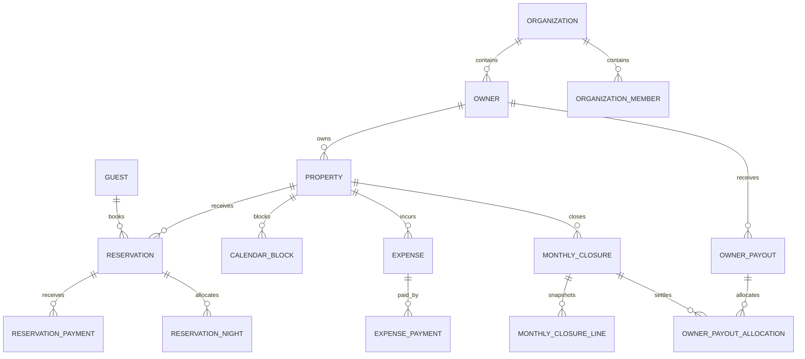

# Modèle SQL Server — HostGridDb

Un DbContext, Code First migrations, schémas `identity`, `organization`, `property`, `booking`, `finance`, `expense`, `operation`, `document`, `communication`, `reporting`, `system`. GUID séquentiels (stratégie SQL/EF compatible), nvarchar Unicode, decimal(18,2) montants, decimal(5,2) taux 0–100, date pour nuitées, time pour heures locales, datetime2 UTC pour événements, smallint enums, rowversion sur agrégats modifiables. MAD uniquement. OrganizationId sur entités tenant, FK composites (OrganizationId, Id) pour empêcher références croisées. Restrict delete pour historique ; archivage/annulation, suppression physique seulement données éligibles sans historique. Seed idempotent rôles/types/catégories ; démo fictive uniquement dev/test.

## Catalogue des entités (colonnes principales, à compléter par conventions)
| Schéma | Entité | Champs et relations |
|---|---|---|
| identity | ApplicationUser, ApplicationRole et tables Identity | email normalisé, activation, MFA ; rôles globaux et memberships contextualisés |
| identity | RefreshToken | UserId, hash, family, expiry, revokedAt, replacedBy |
| organization | Organization | nom, statut, référence |
| organization | OrganizationMember | OrganizationId, UserId, rôle ; unique membership |
| organization | OrganizationSettings | branding, langue, paramètres |
| organization | Owner | UserId, coordonnées, référence ; 1:N Property |
| identity | UserPreferences | UserId, langue, thème |
| property | Property | OwnerId, TypeId, Reference, Name, Description, Address, City, latitude/longitude, MaxGuests, Bedrooms, Bathrooms, BaseNightlyRate, CheckInTime, CheckOutTime, Status, OperationalStatus |
| property | PropertyType, Amenity, PropertyAmenity | catalogues et liaison |
| property | PropertyPhoto, PropertyInventoryItem | FileId ; équipement, quantité, état |
| property | ManagementContract | PropertyId, OwnerId, début/fin, taux, FileId |
| property | CommissionRateHistory | PropertyId, effectiveFrom/To, Rate |
| property | SeasonalRate | PropertyId, dates, jours, prix, priorité |
| property | PropertyListing | PropertyId, Source, URL/ref externe facultative |
| booking | Guest | nom, téléphone et e-mail facultatifs, clés de rapprochement normalisées, création/modification UTC, rowversion |
| booking | Reservation | PropertyId, GuestId, Reference, Source, ExternalBookingId, CheckInDate, CheckOutDate, Adults, Children, GrossAmount nullable si net seul, PlatformFees nullable, RevenueInputMode, NetPlatformRevenue, CommissionRateSnapshot et CommissionAmount nullables avant confirmation, Status, PaymentStatus, ActualCheckInAt/OutAt, AvailabilityReleasedFrom/At/By nullables, Notes |
| booking | ReservationPayment | ReservationId, amount, date, receiver, method, reference |
| booking | ReservationCancellation | ReservationId unique, reason, date, retainedFee |
| booking | ReservationRefund | ReservationId, PaymentId si applicable, amount, date, payer, reference |
| booking | ReservationStatusHistory | ReservationId, old/new status, actor, date |
| booking | CalendarBlock | PropertyId, start/end exclusif, reason, status |
| booking | ReservationNight | ReservationId, PropertyId, NightDate, allocation net/commission, snapshot ; une ligne par réservation/nuit. Les conflits d'occupation entre réservations et blocages sont contrôlés sous verrou SQL partagé par bien. |
| booking | ReservationPriceRevision | réservation tenant, révision unique par réservation, dates, mode, totaux, date UTC et acteur. |
| booking | ReservationNightPrice | révision tenant, date unique par révision, prix accepté, provenance, règle facultative et indicateur de substitution. |

Une réservation dispose aussi de métadonnées de confirmation, de dates historiques facultatives, de l'acteur de saisie et d'un lien tenant vers le PDF privé. Les métadonnées legacy inconnues restent null. La référence externe est facultative et unique par organisation et source, sensible à la casse.
| expense | ExpenseCategory | nom, statut |
| expense | Expense | PropertyId, CategoryId, Reference, Title, Description, Amount, ExpenseDate, DueDate, InvoiceNumber, RecurringTemplateId, Status, actor |
| expense | ExpensePayment | ExpenseId, amount, date, payer, method, reference |
| expense | ExpenseAttachment | ExpenseId, FileId |
| expense | RecurringExpenseTemplate | PropertyId, catégorie, montant, cadence, prochaine échéance, actif |
| expense | ExpenseReimbursement | ExpensePaymentId, montant, date, bénéficiaire, référence |
| finance | MonthlyClosure | PropertyId, OwnerId snapshot, Year, Month, gross/fees connus, net, commission, expenses, profit, advances, ownerDirectPayments, payoutDueAtClosing, status, closedAt/by |
| finance | MonthlyClosureLine | ClosureId, source type/id, période, montant, snapshot et allocation |
| finance | CommissionAdjustment, FinancialAdjustment | source, période origine/cible, motif, montant signé, acteur |
| finance | OwnerPayout | OwnerId, montant, date, méthode, statut, référence |
| finance | OwnerPayoutAllocation | PayoutId, ClosureId, montant |
| finance | FinancialTransaction | type, source, amount, date, payer/receiver, idempotency key ; journal simple |
| operation | CleaningTask | PropertyId, ReservationId nullable, automatic, contact, dates, status |
| operation | ChecklistTemplate, ChecklistTemplateItem | PropertyId, ordre, libellé |
| operation | CleaningChecklistItem | CleaningTaskId, snapshot libellé, checked |
| operation | MaintenanceTicket | PropertyId, title, description, priority, status, contact, dates |
| operation | ExternalContact | nom, téléphone, spécialité, sans compte |
| operation | WorkTask | PropertyId, type, source, status, dates, contact |
| operation | OperationAttachment, OperationExpenseLink | lien typé vers intervention, FileId/ExpenseId |
| document | StoredFile | storage key, nom original, MIME, taille, hash, scan status, uploader |
| document | PropertyDocument | PropertyId, FileId, type |
| communication | OwnerRequest | OwnerId, PropertyId, type, description, status |
| communication | OwnerRequestMessage, OwnerRequestStatusHistory | RequestId, auteur, contenu/transition, date |
| communication | Notification, NotificationPreference | UserId, type, readAt, paramètres |
| communication | EmailOutbox | destinataire, template, status, retries, nextAttempt, lease |
| reporting | Report, DashboardPreference | scope, filtres, FileId ; UserId, layout/widgets |
| system | AuditLog, BackgroundJobExecution | acteur, tenant, action, valeurs filtrées ; job key, état, lease, tentatives |

## Contraintes
Unique (tenant, reference) par ressource ; (tenant, property, year, month) pour clôture ; external booking ID unique filtré par tenant/source si présent ; une occurrence récurrente par template/période ; un nettoyage automatique par réservation ; allocation financière unique par source/période/type ; FK tenant cohérentes. Check dates start < end, montants non négatifs sauf ajustements/solde signés, taux bornés, paiements/remboursements cumulés contrôlés en transaction. Index tenant/property/dates pour réservation/blocage, tenant/property/expenseDate, owner, notification user/read/date, audit tenant/date, jobs status/nextAttempt. Interdire chevauchements via verrou transactionnel par bien (ou occupation unifiée avec index unique par nuit) couvrant réservations ET blocages, pas seulement vérification préalable. Tester concurrence réelle SQL Server.

## Statuts
Reservation Pending/Confirmed/CheckedIn/CheckedOut/Cancelled/NoShow ; Payment Unpaid/PartiallyPaid/Paid/PartiallyRefunded/Refunded ; Expense Draft/Confirmed/Cancelled ; Closure Draft/Closed ; Cleaning Pending/InProgress/Completed/Cancelled ; Maintenance Open/InProgress/Resolved/Cancelled ; WorkTask Todo/InProgress/Done/Cancelled ; Request Submitted/InReview/Approved/Rejected/Completed/Cancelled ; Property Active/Inactive/Archived ; Operational Ready/NeedsCleaning/Cleaning/Maintenance/Unavailable ; Payout Pending/Completed/Cancelled. Transitions contrôlées côté service, historique. Statut paiement dérivé des mouvements. Pas de suppression cascade d'historique.

## ERD conceptuel

Générer ERD complet depuis modèle réel après migrations. Le catalogue est conceptuel ; les noms/champs additionnels doivent être documentés, sans inventer de fonctionnalités.
