# Database relationship diagrams

The diagrams show the persisted entities grouped by dependent schema. The label names each foreign key field. Every tenant-to-tenant link also includes `OrganizationId`. Typed historical source references are described in [DATABASE.md](DATABASE.md).

## Identity

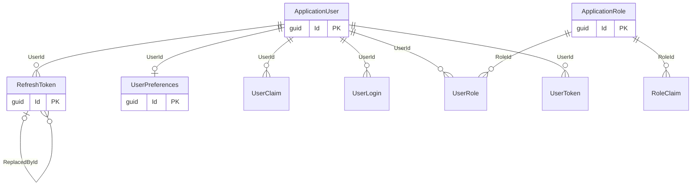

## Organizations and owners

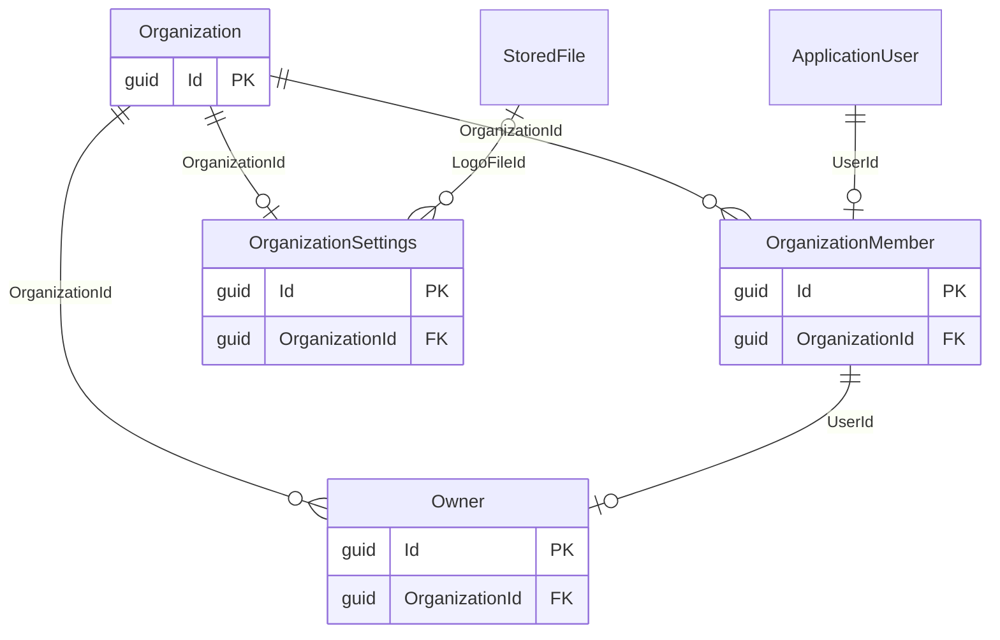

## Properties

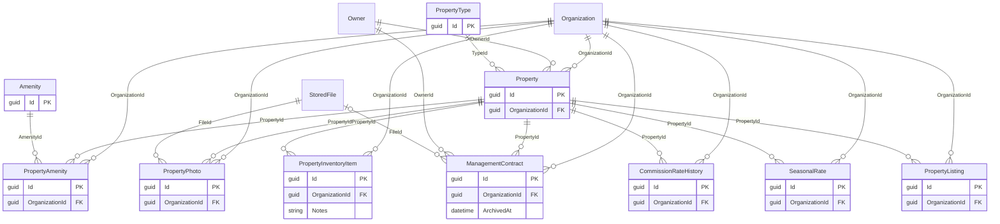

## Bookings and calendar

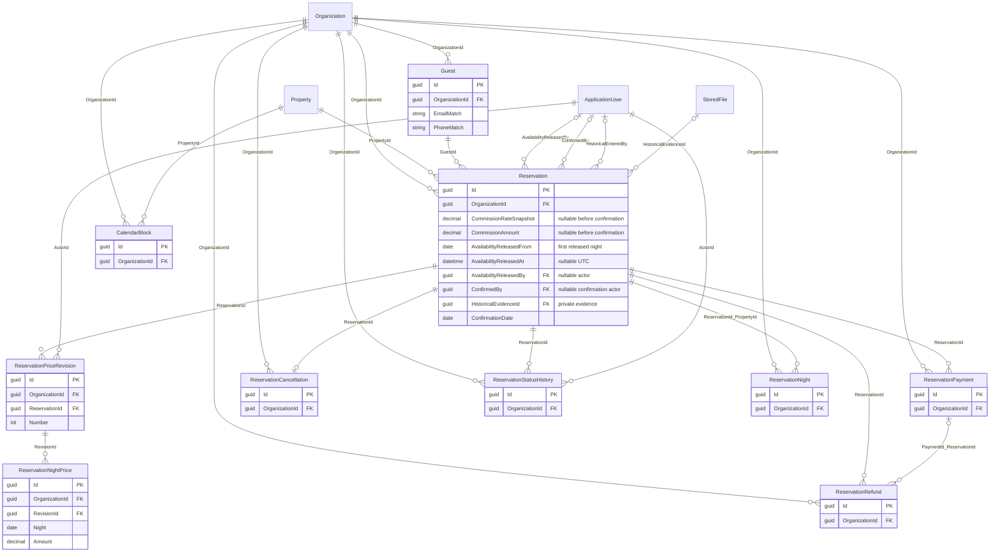

## Expenses

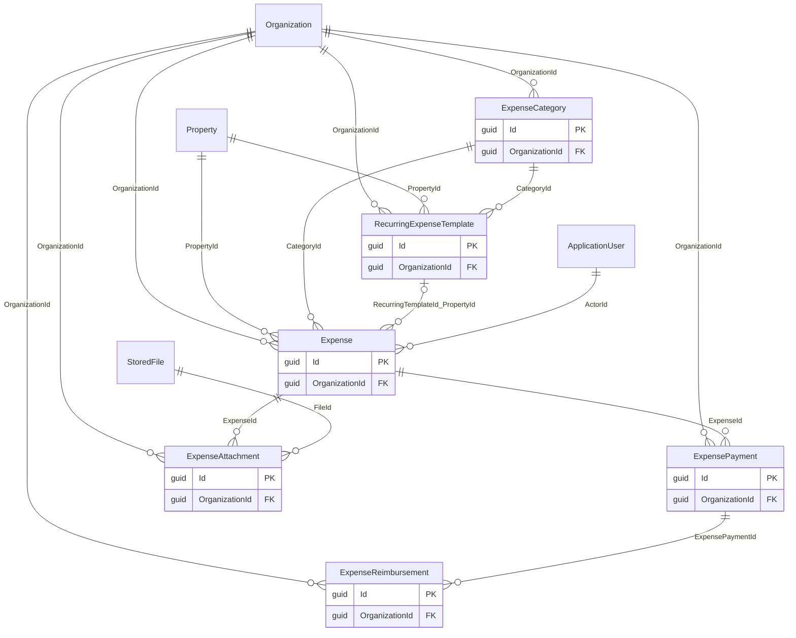

## Finance and payouts

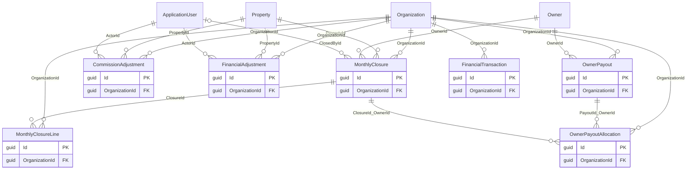

## Operations

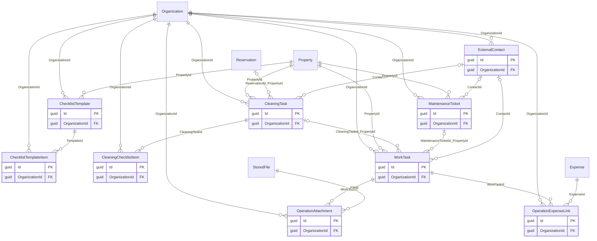

## Documents

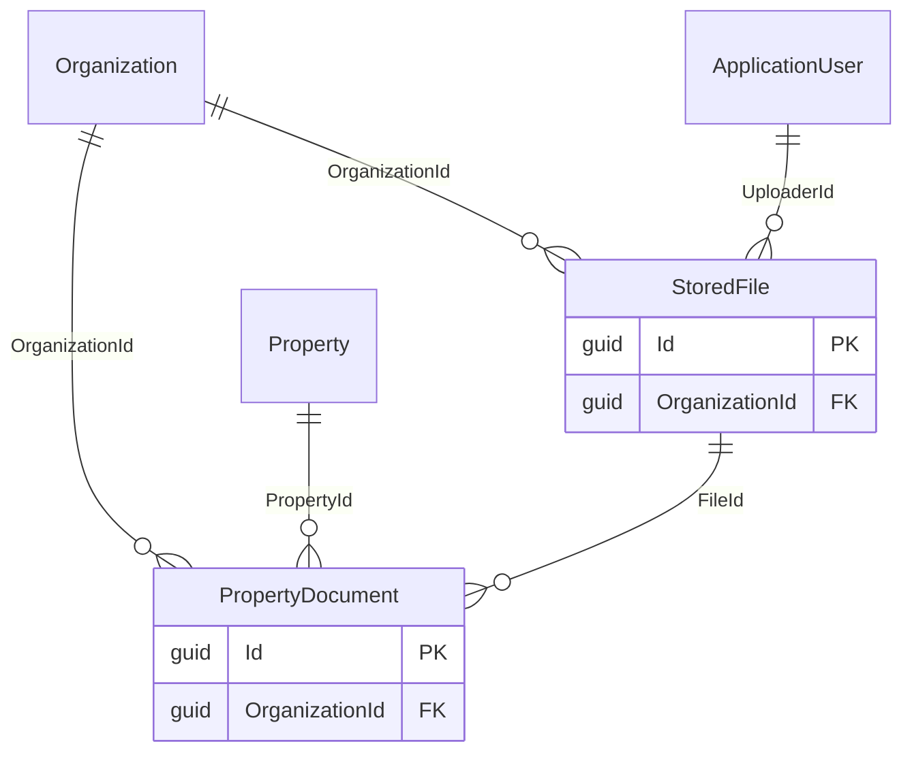

## Communication

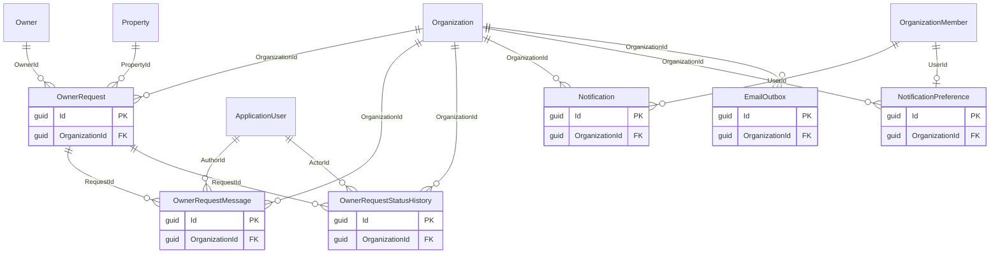

## Reporting

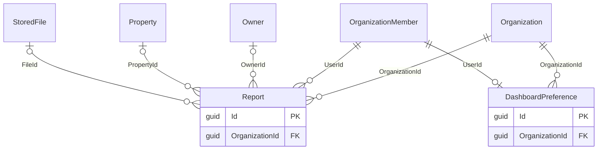

## System

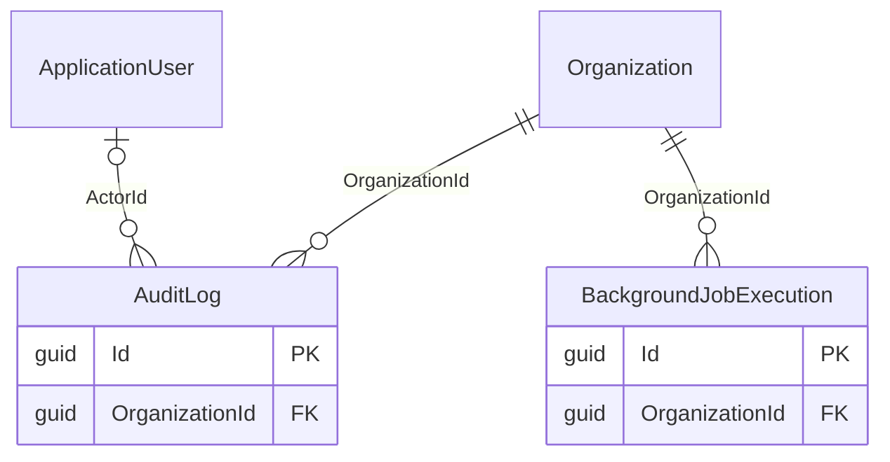
